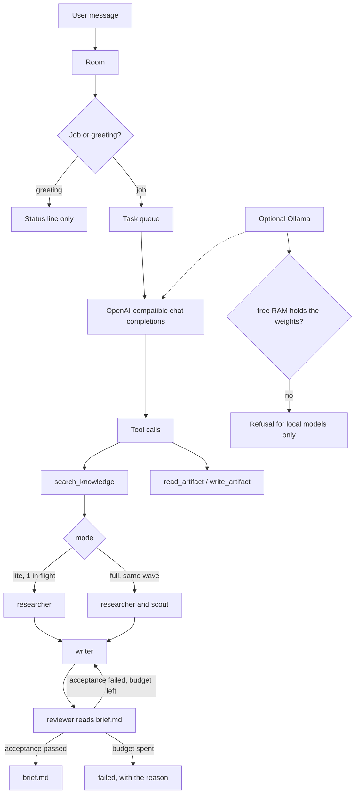

# Workshop v2

A DIY multi-agent orchestrator. Agents have names and skills. They do the work by calling tools (search the knowledge folder, read and write artifact files, optionally fetch a public https page). The orchestrator assigns tasks. A task ends when its artifact meets the acceptance checks, when the agent asks one question, or when the turn budget is spent. Idle conversation is rejected.

The primary model is any cheap OpenAI-compatible API. Weights stay on that API, so an ordinary laptop is enough. Ollama is optional. This is not Grok Bot, OpenClaw, or a hosted clone of either.

## Why a new package

`bot/core.py` runs a 5-stage council: each persona writes an opinion, they comment on each other, a chairman summarizes. That is useful as advice. It has no task owner, no artifact, and no stop condition beyond "the stages finished", so on a small machine it feels like bots chatting.

The LINE server described in `START-HERE.md` is not checked in. The walkthrough expects an agent to build it from `LINE_RAG_Claude_Code_Master_Prompt.md`.

`workshop/` is the work path. Python stayed: the repo is already Python, `bot/llm.py` already speaks Ollama and OpenAI-compatible APIs, and the missing piece was the control loop, not the language.

`bot/`, `council/`, and the LINE guide stay where they are. They are the deliberation and setup layers. They are not quarantined, because deleting them would throw away a working council and the owner's station guide.

## Flow



Waves are the unit of concurrency. Lite's cap is 1, so every wave is a single task. Full's cap is 4; the demo puts `research_facts` and `research_limits` in one wave and leaves the writer and reviewer in later waves, because they depend on the notes.

## Turn contract

The model replies with one JSON object:

| action | meaning |
|---|---|
| `advance` / `done` | the artifact is the work product |
| `ask` | one question, mission status `blocked`, no further calls |
| `yield` | silence; no agent line in the visible room |

Text without that object, or text that greets the room, is a rejected turn. The raw chatter is not posted. The same task may be tried once more, with the rejection reason in the prompt. A second failure marks the mission `failed`.

The reviewer may approve. The orchestrator still runs the acceptance checks (citation, refusal boundary, length, the `@writer` word cap). A hollow approval becomes one revision handoff to the writer. `max_revisions` is 1. `max_turns` is 8.

## Memory

RAM is checked only when `WORKSHOP_PROVIDER=ollama`.

- API provider (`openai`, including OpenRouter and Groq via `LLM_BASE_URL`): no weight RAM, no floor, no refusal. `lite` and `full` only change how many agents run at once.
- Local provider: required free RAM ≈ model weight + 1.5 GB headroom + 0.5 GB for each extra in-flight request. There is no installed-RAM floor.
- Weights for known names live in `KNOWN_MODELS_GB`. They are Q4 planning budgets, not a benchmark.
- An unknown local name raises `WorkshopConfigError` until `WORKSHOP_MODEL_GB` is set.
- `LLM_API_KEY` is read from the environment. The repo ships a placeholder in `.env.example` only.
- `scripted` (`--offline`) runs the same tools with no network. The smoke test uses it, plus a fake HTTP round-trip of the OpenAI tool payload.

`WORKSHOP_I_ACCEPT_RISK=1` skips the local refusal. The estimate is still printed.

## Room

`Room.mentions_for(agent)` returns user lines that contain `@agent` or `@everyone`. The writer's prompt sees `@writer`. The researcher's prompt does not. A short greeting (`hi`) never enters the queue: status `yielded`, zero model calls.

## Retrieval

`search_knowledge` calls `workshop/rag.py`, which scores markdown and text under `knowledge/` by token overlap and returns paths plus excerpts. The librarian and the researcher must call that tool. They do not receive the folder in the prompt and then pretend they searched. The demo mission asks for filing rules and refusal rules, which the sample pages already state. The workshop does not invent corpus pages. `fetch_url` accepts public https only and refuses private addresses. There is no shell tool.

## How to run

From the repo root, after `LLM_API_KEY` is in `.env`:

```bash
pip install -r requirements.txt
python -m workshop demo
python -m workshop demo --offline
python scripts/smoke_workshop.py
python -m workshop demo --local
```

`--local` uses Ollama at `http://127.0.0.1:11434`. The default model for that flag is `qwen2.5:3b` unless `WORKSHOP_MODEL` names a known local model.

## Files

| Path | Role |
|---|---|
| `workshop/orchestrator.py` | queue, waves, acceptance, revision cap |
| `workshop/demo.py` | retrieve → research → brief → review |
| `workshop/room.py` | transcript and silence |
| `workshop/rag.py` | local lexical search |
| `workshop/config.py` | modes and the RAM refusal |
| `workshop/tools.py` | search, read, write, bounded fetch |
| `workshop/llm.py` | OpenAI-compatible tools, optional Ollama, scripted rehearsal |
| `workshop.yaml` | defaults |
| `tests/test_workshop.py` | smoke coverage |
| `scripts/smoke_workshop.py` | one command that must exit 0 |
